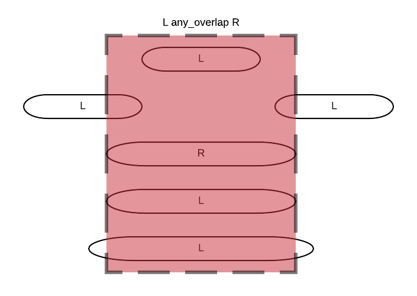

# ConceptQL Specification

[ConceptQL](https://github.com/outcomesinsights/conceptql) (pronounced concept-Q-L) is a high-level language that lets researchers define their research algorithms without ambiguity. It has run in production since 2014 as the core of our study-building software, [Jigsaw](https://jigsaw.io).

Its implementation has changed considerably over that time, but it has kept its original goals.

## Motivation for ConceptQL

Outcomes Insights has built a large library of research algorithms and has applied them to large databases of claims data. Early in that work, we had to solve two problems:

1. Methods sections of research papers commonly use natural language to specify the criteria used to build cohorts from a claims database.
   - Algorithms defined in natural language are often imprecise, open to multiple interpretations, and difficult to reproduce.
   - Researchers need a language that removes the ambiguity of natural language and makes their algorithms reproducible.
2. Querying claims databases is difficult.
   - Hand-coding the queries that extract cohorts from a dataset is slow, error-prone, and opaque.
   - Researchers need a language in which they define an algorithm at a high level, and which a tool translates into the correct database queries.

We developed ConceptQL to solve these two problems.

The reference implementation of ConceptQL reads an algorithm written in ConceptQL. It draws a diagram of the algorithm, which makes the algorithm easy to see and understand. It also translates the algorithm into SQL that runs against data in the [Generalized Data Model (GDM)](https://github.com/outcomesinsights/generalized_data_model). The GDM standardizes the format and content of observational data, so that standard applications, tools and methods can use them.

For example, ConceptQL takes a statement like this:

```JSON
[ "icd9", "412" ]
```

It draws this diagram:

```ConceptQL
[
  "icd9",
  "412"
]
```

And it generates SQL like this (simplified):

```SQL
SELECT patient_id AS person_id,
  id AS criterion_id,
  'clinical_codes' AS criterion_table,
  'condition_occurrence' AS criterion_domain,
  start_date,
  end_date,
  clinical_code_source_value AS source_value
FROM clinical_codes
WHERE clinical_code_vocabulary_id = 'ICD9CM'
  AND clinical_code_concept_id IN (44820864)
```

ConceptQL looks up the concept ID of each code in the vocabulary tables when it builds the SQL. Here, 44820864 is the concept for ICD-9-CM 412.

One goal of ConceptQL is to let researchers assemble complex queries without writing SQL. To support that complexity, ConceptQL has some complexity of its own. We believe that ConceptQL helps researchers define, refine, and share their research algorithms.

## ConceptQL Overview

### What ConceptQL Looks Like

A ConceptQL statement is a set of nested arrays and hashes. This example is in YAML, but JSON or any other format that can represent nested arrays and hashes works equally well. If you squint, it looks a bit like [Lisp](<https://en.wikipedia.org/wiki/Lisp_(programming_language)>): the nested arrays are [S-expressions](https://en.wikipedia.org/wiki/S-expression).

ConceptQL is a domain-specific, declarative language. It represents search criteria, and it combines them with set operations and temporal operations.

```YAML
# Example 1: A simple example in YAML
# The first element is the operator, icd9cm.  The second element is a code, 412.
# This statement selects every record with the ICD-9-CM diagnosis code 412.
---
- icd9cm
- '412'
```

The first element of each array is the name of an operator. The other elements are the operator's arguments, its upstream operators, and a hash of options. Codes are strings, so quote them in YAML. Operator names are not case-sensitive.

### ConceptQL Diagrams

ConceptQL in YAML or JSON can be hard to read. A directed graph is often easier to explore. This is the diagram for the YAML example above:

```ConceptQL
# All Conditions Matching MI
[
  "icd9",
  "412"
]
```

Each node in a diagram is an operator. A line between two operators shows that the records of the upper operator flow down into the lower operator. Each line is labeled with the number of records (`rows=`) and people (`n=`) that flow along it in our test data. Here is a slightly larger example:

```ConceptQL
# First Office Visit Per Patient
[
  "first",
  [
    "cpt",
    "99214"
  ]
]
```

The diagram above reads "get all procedures that match CPT 99214 (office visit), and then keep only the first one (by date) for each person". More briefly: "get the first office visit for each patient". To read a diagram accurately, you need to know how each operator works. This document describes each operator.

Every diagram ends with a line that leads to nothing. The next section explains why.

### Think of Records as a Stream

A ConceptQL diagram has the "leaf" operators at the top and the "trunk" operator at the bottom. Think of the records of a ConceptQL statement as a stream of data. The leaf operators select records from the database, and they act as the sources of the stream. The records flow down through the diagram. Some operators combine streams, and others remove records, until one stream comes out at the bottom of the diagram.

The trailing line in each diagram is a reminder that every ConceptQL statement yields a stream of records.

### Streams Have Types

Each record has a type. The type is the `criterion_domain` column of the record. A vocabulary operator takes its type from the vocabulary's domain. For example, ICD-9-CM records are `condition_occurrence` records, and CPT records are `procedure_occurrence` records. Other operators produce a fixed type, such as `person` or `death`.

The diagrams use color to show types. The node of an operator and the lines that leave it have the color of the types that it outputs:

| Type                 | Color  | Comes from, for example                                                  |
| -------------------- | ------ | ------------------------------------------------------------------------ |
| condition_occurrence | red    | diagnosis codes (icd9cm, icd10cm, snomed), hospitalization, snf, hospice |
| death                | brown  | death                                                                    |
| drug_exposure        | purple | drug codes (ndc, rxnorm)                                                 |
| person               | blue   | person, gender, race, ethnicity, date_range                              |
| procedure_occurrence | green  | procedure codes (cpt4, hcpcs, icd9proc, icd10pcs)                        |
| observation_period   | teal   | information_periods                                                      |
| observation          | gray   | lab codes (loinc)                                                        |
| episode              | gray   | episode                                                                  |

An operator that outputs more than one type has a gray node, and the line that leaves it is drawn as one colored line for each type, side by side.

The type stays with each record as it moves through the operators. Some operators use the type when they compare records. For example, `filter` and `except` match a record only with a record from the same table. Other operators, such as `first` and `person_filter`, ignore the type. Each operator's description says which applies.

### Why Types?

ConceptQL was first written to query [OMOP's CDM v4.0](https://github.com/OHDSI/CommonDataModel/releases/tag/v4). In that model, each table held one type of data (condition_occurrence, procedure_occurrence, visit_occurrence, and so on), and ConceptQL treated each type as distinct.

ConceptQL now runs against the [GDM](https://github.com/outcomesinsights/generalized_data_model), where most codes of all types are in one table, `clinical_codes`. Types matter less now. ConceptQL keeps them to help users see which kinds of data a statement selects.

### What *are* Streams Really?

Thinking in streams is helpful, but sometimes we need to know what happens in the database.

A stream is a set of rows. Each row points back to one row of a GDM table, and it always has these columns:

- `person_id`: the patient.
- `criterion_id`: the ID of the row in its table of origin.
- `criterion_table`: the table of origin, such as `clinical_codes`, `patients` or `deaths`.
- `criterion_domain`: the type of the record (see above).
- `start_date` and `end_date`: the dates of the record.
- `source_value` and `source_vocabulary_id`: the code of the record and its vocabulary, when the record has a code.
- `label`: the label of the nearest upstream operator that has one (see [`label`](#label-option-and-its-features)).

Some operators add columns. For example, lab records (loinc) add `value_as_number` and unit columns, and the utilization operators add admission and discharge columns.

So this statement yields one row for each male patient, pointing at the `patients` table:

```ConceptQL
# All Male Patients
[
  "gender",
  "Male"
]
```

This statement yields one row for each `clinical_codes` row that has the ICD-9-CM code 250.01:

```ConceptQL
# All Condition Occurrences that match ICD-9CM 250.01
[
  "icd9",
  "250.01"
]
```

It usually helps to think of these queries as a "stream of people" or a "stream of conditions", and not to think about tables and IDs.

A ConceptQL statement yields the rows that pass all of its criteria. What to do with those rows is up to the system that runs the statement. For example, a system that has all 250.01 records could:

- Find the first and last date of occurrence for each person
- Count the occurrences for each person
- Count the people with the condition
- Count the occurrences in the whole population

That kind of aggregation and analysis is outside the scope of ConceptQL. ConceptQL finds the rows that you are interested in. Other parts of the system decide what to do with them.

The rest of this document describes each operator. [Appendix E](#appendix-e---operator-quick-reference) lists every operator in one table.

### Statements That ConceptQL Refuses

ConceptQL checks each statement before it builds SQL for it. A statement with an error is invalid. Examples of errors are an unknown operator, a required option that is missing, and a `recall` of a label that the statement does not have. ConceptQL refuses to build SQL for an invalid statement, and so it does not run it. It reports each error with the name of the operator that has the error.

A warning does not make a statement invalid. Examples of warnings are an unknown code, an improperly formatted code and a deprecated operator. A statement with warnings runs. When ConceptQL draws the diagram of a statement, it shows the errors and the warnings of each operator, and it does not refuse an invalid statement.

ConceptQL finds the concept of each code in the vocabulary tables. It uses either the OHDSI vocabulary tables (`concept`, `concept_ancestor`, `concept_relationship` and `vocabulary`) or the GDM vocabulary tables (`concepts`, `ancestors`, `mappings` and `vocabularies`). It looks for them in the search path of the data database, and then in the database that the environment variable `LEXICON_URL` names. If ConceptQL has a real data database and finds no complete set of vocabulary tables, it refuses to start. Without vocabulary tables, every code would match no records, and a statement would return no records with no warning. Without a database, for example when ConceptQL only draws a diagram, it uses no vocabulary tables. The vocabulary tables of a dataset can be trimmed to the codes that the data contains. Then ConceptQL can also read a full set of vocabulary tables, the reference lexicon, but only to tell a code that the dataset does not contain from a code that does not exist. When `LEXICON_URL` is set and the program names no other reference lexicon, the `LEXICON_URL` database is the reference lexicon.

## Selection Operators

Selection operators select records from the database. For example, a search for diagnoses of old myocardial infarction (ICD-9-CM 412) is a selection. Most selection operators are leaf operators: no other operator flows into them. `person` and `death` can also take one upstream operator (see [`person`](#person-operator)).

The vocabulary operators select records by their codes. The next section describes them, and [Other Selection Operators](#other-selection-operators) describes the rest.

## `Vocabulary` Operator

<!-- conceptql-spec: operator vocabulary-operator -->

ConceptQL creates one vocabulary operator for each vocabulary that it knows, so the list of operators depends on the vocabulary tables. The operator name is the vocabulary ID in lower case, with spaces and punctuation replaced by `_`. Some operators also have a shorter alias. [All Vocabulary Operators](#all-vocabulary-operators) lists every vocabulary operator.

These are the most common vocabulary operators:

| Operator     | Alias          | Vocabulary                                   | Stream type          |
| ------------ | -------------- | -------------------------------------------- | -------------------- |
| cpt4         | cpt            | CPT-4 procedure codes                        | procedure_occurrence |
| hcpcs        |                | HCPCS procedure codes                        | procedure_occurrence |
| cpt_or_hcpcs |                | CPT-4 and HCPCS together                     | procedure_occurrence |
| icd9cm       | icd9           | ICD-9-CM diagnosis codes                     | condition_occurrence |
| icd9proc     | icd9_procedure | ICD-9-CM procedure codes (volume 3)          | procedure_occurrence |
| icd10cm      |                | ICD-10-CM diagnosis codes                    | condition_occurrence |
| icd10pcs     | icd10_pcs      | ICD-10-PCS procedure codes                   | procedure_occurrence |
| ms_drg       |                | MS-DRG codes, for events from 2007-10-01     | procedure_occurrence |
| cms_drg      |                | CMS-DRG codes, for events before 2007-10-01  | procedure_occurrence |
| revenue_code |                | UB-04 revenue codes                          | procedure_occurrence |
| loinc        |                | LOINC lab codes                              | observation          |
| ndc          |                | National Drug Codes (11-digit package codes) | drug_exposure        |
| rxnorm       |                | RxNorm codes                                 | drug_exposure        |
| snomed       |                | SNOMED CT codes                              | condition_occurrence |

Examples of how codes match:

- `V58.61` matches, but `v58.61` does not.
- ConceptQL does not expand a code to its child codes, so `584` does not match `584.9`.
- `410*` matches nothing, because `*` is a wildcard only as a code alone.
- A code that does not have the vocabulary's format gives the warning "improperly formatted code".
- A code that the vocabulary does not contain gives the warning "unknown code(s)".
- When ConceptQL has a full lexicon (the reference lexicon) beside the vocabulary tables of the dataset, a code that only the full lexicon contains gives the warning "code(s) not present in this dataset", not "unknown code(s)". It is a warning, so the statement stays valid on a dataset that lacks some of its codes.
- A code that has more than one meaning in the vocabulary gives the warning "code(s) with more than one meaning".
- Some data stores CPT-4 and HCPCS codes only in the merged vocabulary CPT4_HCPCS. On that data, `cpt` and `hcpcs` select nothing, because they read only CPT4 and HCPCS. They give the warning "the data has no records of this vocabulary", which names `cpt_or_hcpcs`. Use `cpt_or_hcpcs`, which reads all three vocabularies.
- When the data lists the vocabularies of its records (the GDM table `etl_vocabulary_ids`) and the operator's vocabulary is not in the list, the operator gives the warning "the data has no records of this vocabulary". Its counts are null, not 0, because the data cannot show whether a patient has the codes. This warning covers all of its codes, so they get no other warning, except the warning for an improperly formatted code.
- `rxnorm` does not find records coded with NDC, because an operator does not follow mappings between vocabularies.

### DRG Codes

CMS renumbered the Diagnosis-Related Group (DRG) codes on 2007-10-01, when the MS-DRG system replaced the CMS-DRG system. Most codes got a new meaning. For example, DRG 205 meant a liver disorder in CMS-DRG, and it means other respiratory system diagnoses in MS-DRG. One vocabulary, DRG, holds the codes of both systems, and a record does not say which meaning applied. So a statement names the DRG system, and ConceptQL selects each record by its code and by its start_date:

- `ms_drg` selects the DRG records whose start_date is on or after 2007-10-01.
- `cms_drg` selects the DRG records whose start_date is before 2007-10-01.

The examples above show both operators. Our test data has no DRG record before 2007-10-01, so the `cms_drg` example returns no records.

Both operators check codes as the other vocabulary operators do. A DRG code has 3 digits, with leading zeros. A code that the DRG vocabulary does not have gets the warning "unknown code(s)". These operators never give the warning "code(s) with more than one meaning", because the operator chooses the meaning.

The `drg` operator is deprecated. It selects the DRG records of both systems, whatever their dates. A statement that uses `drg` still runs, but `drg` gets the warning "deprecated operator", and a later release will make it an error. Use `ms_drg` or `cms_drg`.

### All Vocabulary Operators

The build writes this table from the metadata of the operators. It lists the vocabulary operators of a ConceptQL database with no vocabulary tables, ordered by name. Each row gives the full name of the operator's vocabulary and the domain, which is the type of the records that the operator returns. The vocabulary tables of a database can add more operators. A deprecated operator still runs, with a warning.

<!-- conceptql-spec: vocabulary-operators -->

## Other Selection Operators

This section describes the selection operators that are not vocabulary operators.

### Person-related Operators

Person operators select records from the `patients` table, which holds the patient demographics. The type of these records is `person`. The start_date and end_date of a person record are both the patient's birth date. [Temporal Operators and Person Streams](#temporal-operators-and-person-streams) explains why that is useful.

#### `Gender` Operator

<!-- conceptql-spec: operator gender-operator -->

#### `Race` Operator

<!-- conceptql-spec: operator race-operator -->

#### `Ethnicity` Operator

<!-- conceptql-spec: operator ethnicity-operator -->

#### `Person` Operator

<!-- conceptql-spec: operator person-operator -->

### Additional Selection Operators

#### `Death` Operator

<!-- conceptql-spec: operator death-operator -->

#### `Information Periods` Operator

<!-- conceptql-spec: operator information-periods-operator -->

### Utilization Operators

Utilization operators select admissions. Each operator returns one record for each admission whose claim came from the matching kind of file. For example, `hospitalization` uses the claims whose file provenance is inpatient.

The type of these records is `condition_occurrence`, because the GDM has no visit or admission type. So `union` combines them with diagnosis records into one stream. `source_value` usually holds a diagnosis.

Our test data has no SNF claims and no hospice claims, so the examples of `snf` and `hospice` return no records.

#### `SNF` Operator

<!-- conceptql-spec: operator snf-operator -->

#### `Hospice` Operator

<!-- conceptql-spec: operator hospice-operator -->

#### `Hospitalization` Operator

<!-- conceptql-spec: operator hospitalization-operator -->

## Set Operators

Streams are sets of records, so ConceptQL has operators that work on sets.

### `Union` Operator

<!-- conceptql-spec: operator union-operator -->

Union does not change records of different types. Each later operator decides whether it treats the types separately or together.

### `Except` Operator

<!-- conceptql-spec: operator except-operator -->

A left-hand record matches only a right-hand record from the same table, and only when the dates are the same. For example, a record whose dates `time_window` changed no longer matches the original record. The second example above shows that a left-hand record passes through unchanged when no right-hand record comes from its table. The third example has several types in the left-hand stream.

### Discussion About Set Operators

Why can one stream hold records of several types? Because operators such as `first` then act across all the types. For example, the statement below finds the first MI or death for each patient. Add a few more criteria, and you can find the first censoring event for each patient.

```ConceptQL
# First occurrence of either MI or Death for each patient
[
  "first",
  [
    "union",
    [
      "icd9",
      "412"
    ],
    [
      "death"
    ]
  ]
]
```

## Time-oriented Operators

Every record has a start_date and an end_date. All temporal comparisons use these two columns. Each record takes its dates from its row in its table of origin.

If the table of origin has only one date, the record uses that date as both its start_date and its end_date. For example, a death record uses the `date` column of its row in `deaths`.

Person records are a special case. A person record uses the patient's birth date as its start_date and end_date. This may sound strange, but [Temporal Operators and Person Streams](#temporal-operators-and-person-streams) shows why it is useful.

## Relative Temporal Operators

For each patient, we may want only the chronologically first or last record, or the second, or the second-to-last. Relative temporal operators provide this filtering. They order each patient's records by start_date. When two records have the same start_date, the record with the lower `criterion_id` comes first.

### `Nth Occurrence` Operator

<!-- conceptql-spec: operator nth-occurrence-operator -->

`at_least` and `within` take date adjustments, as [`time_window`](#time-window-operator) does. With `group_by_date`, several codes on the same day count as one occurrence. The second example above finds, for each patient, the second day on which any of its codes appears.

### `First` Operator

<!-- conceptql-spec: operator first-operator -->

`first` is the same as `["occurrence", 1, ...]`. It does not accept `at_least`, `within` or `group_by_date`.

### `Last` Operator

<!-- conceptql-spec: operator last-operator -->

`last` is the same as `["occurrence", -1, ...]`. It does not accept `at_least`, `within` or `group_by_date`.

## Date Literals

To represent a fixed range of dates, use the `date_range` operator.

### `Date Range` Operator

<!-- conceptql-spec: operator date-range-operator -->

The range includes both dates. A `YYYY-MM-DD` date has a four-digit year, a two-digit month, and a two-digit day, with leading zeros. There is no operator for a single day. Use `date_range` with the same start and end.

## Temporal Comparison Operators

As described above, each record has a start date and an end date, which define its own date range. Temporal operators filter streams by comparing these date ranges.

A temporal operator takes two streams: the left-hand records (LHR) and the right-hand records (RHR). It compares each patient's LHR with the same patient's RHR, and it passes along the LHR that pass the comparison. It discards the RHR after the comparison.

- Each LHR is passed along at most once, however many RHR it matches.
- A patient who has LHR but no RHR loses all of their LHR.
- A record that is in both streams can match itself. For example, a record is during itself.

Edge behaviors: `during`, `contains` and `any_overlap` compare each LHR with every RHR of the patient. `before` and `after` do not. Without the `within` option, `before` compares each LHR only with the latest start_date of the patient's RHR, and `after` compares each LHR only with the earliest end_date of the patient's RHR. [`before`](#before-operator) and [`after`](#after-operator) explain why, and [Working Around `Before`/`After` Behavior](#working-around-beforeafter-behavior) shows how to choose another RHR.

Each operator compares the dates in a different way. All of them take [some options](#temporal-comparison-operator-options), which are described later.

### `During` Operator

<!-- conceptql-spec: operator during-operator -->

### `Contains` Operator

<!-- conceptql-spec: operator contains-operator -->

### `Any Overlap` Operator

<!-- conceptql-spec: operator any-overlap-operator -->

This diagram shows each kind of L record that has "any overlap" with an R record:



### `Before` Operator

<!-- conceptql-spec: operator before-operator -->

The comparison is strict, so an LHR that ends on the day the RHR starts does not pass.

This rule needs some explanation. Imagine the events A-A-B-A-B-A. How many A's come before a B? One could argue that only the first two A's qualify, because they come before the first B. But three A's come before some B. The `before` operator uses the second answer, so it compares every LHR with the start_date of the patient's last RHR.

### `After` Operator

<!-- conceptql-spec: operator after-operator -->

The comparison is strict, so an LHR that starts on the day the RHR ends does not pass.

Imagine the events A-A-B-A-B-A again. How many A's come after a B? One could argue that only the last A qualifies, because it comes after the last B. But two A's come after some B. The `after` operator uses the second answer, so it compares every LHR with the earliest end_date of the patient's RHR.

### Working Around `Before`/`After` Behavior

If you want a different RHR for the comparison, use a relative temporal operator to select it. The second example of [`before`](#before-operator) uses `first` to compare each MI with the patient's first case of diabetes.

## Time Manipulation Operators

### `Time Window` Operator

<!-- conceptql-spec: operator time-window-operator -->

More examples of date adjustments:

- `30d` is 30 days.
- `20` is 20 days.
- `d` is 1 day.
- `1y` is 1 year.
- `-2y10m-3d` is back 2 years, forward 10 months, and back 3 days.

### `Trim Date Start` Operator

<!-- conceptql-spec: operator trim-date-start-operator -->

Like a [temporal comparison operator](#temporal-comparison-operators), it takes left-hand and right-hand streams and compares each patient's records. There are four cases:

- The patient has no RHR.
  - The LHR passes through unchanged.
- The RHR end_date is before the LHR start_date.
  - The LHR passes through unchanged.
- The RHR end_date is after the LHR end_date.
  - The LHR is discarded.
- The RHR end_date is between the LHR start_date and end_date.
  - The LHR's start_date becomes the RHR's end_date.

### `Trim Date End` Operator

<!-- conceptql-spec: operator trim-date-end-operator -->

Like a [temporal comparison operator](#temporal-comparison-operators), it takes left-hand and right-hand streams and compares each patient's records. There are four cases:

- The patient has no RHR.
  - The LHR passes through unchanged.
- The RHR start_date is after the LHR end_date.
  - The LHR passes through unchanged.
- The RHR start_date is before the LHR start_date.
  - The LHR is discarded.
- The RHR start_date is between the LHR start_date and end_date.
  - The LHR's end_date becomes the RHR's start_date.

### The `join_columns`, `compare_all` and `uuid` Options

Systems that build statements, such as Jigsaw's export engine, give `trim_date_start` and `trim_date_end` two more options. Jigsaw's diagram editor does not show them.

- `join_columns`: a list of column names. Each LHR is compared only with the RHR of the same patient that have the same values in these columns. Without `compare_all`, the operator uses the first RHR (`trim_date_end`) or the last RHR (`trim_date_start`) of each patient and each set of `join_columns` values. The RHR are ordered by start_date and then by `criterion_id`.
- `compare_all` (boolean): compare each LHR with every RHR of the patient (and of the `join_columns` values), not only with the first or the last RHR. Each LHR comes out at most once.
  - `trim_date_end` moves the end_date of the LHR back to the earliest RHR start_date that is on or after the LHR start_date.
  - `trim_date_start` moves the start_date of the LHR forward to the latest RHR end_date that is on or before the LHR end_date.
  - The `within` option moves each RHR date before the comparison, as above.
  - An LHR is discarded only when it has RHR (of its patient and its `join_columns` values) and none of them qualifies. An LHR without RHR passes through unchanged.

These systems often join on the column `uuid`. A selection operator, such as a vocabulary operator, takes the option `uuid` (`{"uuid": true}`), which adds the column `uuid` to its records. The uuid is the `person_id`, `criterion_id`, `criterion_table`, start_date and end_date of the record, joined with `/`, such as `17/27269/observations/2008-08-25/2008-08-25`. An empty part is an empty string, so a record without an end_date has a uuid such as `1/2/observations/2008-03-10/`. The uuid keeps its value when a later operator, such as `time_window`, moves the dates. So two streams made from the same records can be joined record by record.

This example makes a one-year window after each MI. Then it trims each window to end 30 days after its own MI. The `join_columns` option makes sure that no other MI of the same patient trims the window:

```ConceptQL
# Each MI's following year, trimmed to end 30 days after that same MI
[
  "trim_date_end",
  {
    "left": [
      "time_window",
      [ "icd9", "412", { "uuid": true } ],
      { "end": "+1y" }
    ],
    "right": [
      "time_window",
      [ "icd9", "412", { "uuid": true } ],
      { "start": "+30d", "end": "+30d" }
    ],
    "join_columns": [ "uuid" ],
    "compare_all": true
  }
]
```

## Temporal Comparison Operator Options

It can be hard to reason with [`time_window`](#time-window-operator) when you use temporal comparison operators. The options `within` and `at_least` describe some common temporal relationships more directly. Every temporal comparison operator except `equal` takes `within`, and `before` and `after` also take `at_least`. The reference section of each operator says what the options do for it.

When `before` or `after` has the `within` option, it compares each LHR with every RHR of the patient, not only with the patient's last or earliest RHR.

Walk-through of the second example of [`after`](#after-operator), which finds the prescriptions of interest within three days after an office visit:

- Select some prescriptions of interest as the LHR.
- Select office visits as the RHR.
- Compare each LHR with each RHR of the same patient. Keep the LHR whose start_date is after the RHR end_date, and no more than 3 days after it.

Walk-through of the third example of [`before`](#before-operator), which asks whether anyone dies within a year of a heart attack:

- Select heart attack diagnoses as the LHR.
- Select death records as the RHR.
- Keep the LHR whose end_date is before the date of death, and no more than 1 year before it.

The third example of [`after`](#after-operator) shows how `at_least` works.

### Temporal Operators and Person Streams

The start and end dates of a person record are the patient's birth date. So a person stream is rarely useful as the left-hand stream of a temporal operator. But it is useful as the right-hand stream. If we move the birth date with `time_window`, we can filter by the patient's age. The last example of [`after`](#after-operator) selects the MIs that occurred after a male patient's 50th birthday.

## `Episode` Operator

<!-- conceptql-spec: operator episode-operator -->

A long record keeps the episode open: the records 2020-01-01 to 2020-03-01 and 2020-01-05 to 2020-01-10 and 2020-02-15 to 2020-02-20 make one episode with `gap_of` 0, because the first record ends after the third record starts. An episode stream is often most useful as the right-hand stream of a [temporal operator](#temporal-comparison-operators).

## Inline-Filter Operators

These operators filter one incoming stream and pass along the records that remain.

### `Place of Service Filter` Operator

<!-- conceptql-spec: operator place-of-service-filter-operator -->

Claims often report the place of service of an event with a CMS place of service code. Our test data has no place of service information, so the example returns no records.

### `Provenance` Operator

<!-- conceptql-spec: operator provenance-operator -->

Provenance is information about the origin of claims data. It is sometimes an important factor in research algorithms. For example, authors often describe "inpatient records", by which they mean claims from the inpatient file of a claims dataset. The [GDM](https://github.com/outcomesinsights/generalized_data_model#contexts) records the provenance of the data during ETL.

These are the keywords of each kind:

- File keywords: `inpatient`, `outpatient`, `carrier_claim`, `claim`, `dme`, `hha`, `hospice`, `snf`, `prescription_drug` and `demographics`.
- Code keywords: `primary`, `primary_or_first`, `first`, `second`, `admitting`, `discharge`, `problem_list`, `chief_complaint` and `unspecified`.

Besides `inpatient`, which includes `snf`, `outpatient` includes `hha` and `hospice`, and `claim` includes every kind of claim file.

### `Provider Filter` Operator

<!-- conceptql-spec: operator provider-filter-operator -->

These are the roles of the GDM_ROLE vocabulary: `100000066` (Performing physician), `100000067` (Attending physician), `100000068` (Operating physician), `100000069` (Other physician), `100176860` (Billing provider), `100176861` (Rendering provider) and `100176862` (Prescribing provider). The operator takes concept IDs, not names of specialties and roles.

Use `*` to skip one half of the filter. This example keeps the diabetes diagnoses that had an attending physician of any specialty. The results show every column, so you can see the provider, both specialty columns, and the role that matched:

```ConceptQL{all_keys: true}
# Diabetes diagnoses with an attending physician of any specialty
[ "provider_filter", [ "icd9", "250.00"], { "specialties": "*", "roles": "100000067" }]
```

### `One In Two Out` Operator

<!-- conceptql-spec: operator one-in-two-out-operator -->

The operator decides between inpatient and outpatient by the provenance of each record (see [`provenance`](#provenance-operator)):

- A record with `inpatient` provenance (which includes SNF) is an inpatient record.
- A record with `outpatient` or `carrier_claim` provenance is an outpatient record.
- Other records, and records whose type is not `condition_occurrence`, are removed.

The place of service of a record does not matter. The two outpatient records need not have the same code. Any two records from the upstream stream can confirm each other. For outpatient records, the operator compares start_dates.

More about the options:

- `outpatient_maximum_gap` helps with acute diseases. For example, to confirm the flu, set a maximum gap so that the two diagnoses come from the same illness. Jigsaw fills in 365 days.
- `outpatient_event_to_return`: use `Initial Event` in most cases, for example when the algorithm records an exposure of interest or an outcome. Use `Confirming Event` when the algorithm finds an index event. The initial event would introduce immortal time bias. Jigsaw fills in `Initial Event`, but a statement that omits the option gets `Confirming Event`. So always set this option.

### `Person Filter` Operator

<!-- conceptql-spec: operator person-filter-operator -->

For example, to find all MIs of males, use `person_filter`. The right-hand stream need not be a person stream, because any record of a patient counts. The left-hand stream can also have several types, as the last example shows.

## Comparison Operators

These operators compare records of incoming streams to produce a set of records.

### `Filter` Operator

<!-- conceptql-spec: operator filter-operator -->

It is an intersection of the two streams. Filter compares records, not date ranges. A record whose dates `time_window` changed no longer matches the original record.

### `Match` Operator

<!-- conceptql-spec: operator match-operator -->

It is stricter than [`filter`](#filter-operator), so most users want `filter`. Systems that build statements, such as Jigsaw's export engine, use match with options that Jigsaw does not show.

### `Co-Reported` Operator

<!-- conceptql-spec: operator co-reported-operator -->

Claims data often reports diagnoses on the same claim as a procedure. This is done for billing: the provider says "I performed this procedure because the patient has these conditions". The `co_reported` operator finds this relationship. In the [GDM](https://github.com/outcomesinsights/generalized_data_model), "the same claim" means the same [context](https://github.com/outcomesinsights/generalized_data_model#contexts). In the example, both the diagnoses and the procedures pass through the operator.

## `label` Option and Its Features

Every ConceptQL operator takes a `label` option, so the reference sections of the operators do not list it:

<!-- conceptql-spec: label-option -->

An operator without a label passes the upstream label through.

For example, here are some diabetes diagnoses with a label:

```ConceptQL{all_keys: true}
["icd9", "250.00", {"label": "diabetes"}]
```

The label of the nearest labeled operator is the one in the output:

```ConceptQL{all_keys: true}
["first", ["icd9", "250.00", {"label": "won't show"}], {"label": "1st diabetes"}]
```

Labels give hints about the output:

```ConceptQL{all_keys: true}
["first", ["union", ["icd9", "250.00", {"label": "diabetes"}], ["icd9", "401.9", {"label": "hypertension"}]]]
```

A label must be a string.

### `Recall` Operator

<!-- conceptql-spec: operator recall-operator -->

## Window Tables

A system can run a statement inside windows. A window is a date range of one patient. Jigsaw's export engine uses windows. The system gives the windows in a window table, and it wraps the statement like this:

```JSON
[ "window", <statement>, { "window_table": <window table> } ]
```

- The window table has the columns `person_id`, `start_date` and `end_date`. It is the name of a database table or a ConceptQL statement.
- Each selection operator keeps only the records whose patient has a window and whose start_date is in that window. Both dates of the window are in the window. The person operators, such as `person` and `gender`, keep each patient who has a window, whatever the dates.
- Each record gets the column `window_id`, which identifies its window. A record that is in two windows of its patient comes out once for each window.
- Operators that work on each patient, such as `first`, `episode` and the temporal operators, work on each patient and window. For example, `first` keeps the first record of each window.
- If the window table is a ConceptQL statement with errors, the statement that it wraps is invalid. A diagram reports the errors under `window_table`, and counts nothing.

## Appendix A - Experimental Operators

These operators work, but they may change or be removed. They compare the `value_as_number` column, which lab records (such as `loinc`) carry.

### `Numeric Filter` Operator

<!-- conceptql-spec: operator numeric-filter-operator -->

It is an [inline filter operator](#inline-filter-operators).

### `Equal` Operator

<!-- conceptql-spec: operator equal-operator -->

Like a [temporal comparison operator](#temporal-comparison-operators), it takes left-hand and right-hand streams.

## Appendix B - Algorithm Showcase

These algorithms are based on [OMOP's Health Outcomes of Interest](http://omop.org/HOI). Some code lists are shortened to keep the diagrams small.

### Acute Kidney Injury - Narrow Definition and diagnostic procedure

- The first diagnosis of acute kidney failure (ICD-9-CM 584.5 to 584.9)
- AND
  - an ICD-9 procedure code 39.95 or 54.98 within 60 days after the diagnosis
- AND NOT
  - a diagnosis of chronic dialysis at any time before the diagnosis
    - V45.1, V56.0, V56.31, V56.32, V56.8

```ConceptQL
[
  "during",
  {
    "left": [
      "except",
      {
        "left": [
          "first",
          ["icd9", "584.5", "584.6", "584.7", "584.8", "584.9"],
          { "label": "First AKI diagnosis" }
        ],
        "right": [
          "after",
          {
            "left": ["recall", "First AKI diagnosis"],
            "right": ["icd9", "V45.1", "V56.0", "V56.31", "V56.32", "V56.8"]
          }
        ]
      }
    ],
    "right": [
      "time_window",
      ["icd9_procedure", "39.95", "54.98"],
      {
        "start": "-60d",
        "end": "0"
      }
    ]
  }
]
```

### Mortality after Myocardial Infarction #3

- The person died
- AND an acute MI diagnosis (ICD-9-CM 410.x) before death
- AND either
  - a diagnostic test or procedure for MI within 30 days before the MI diagnosis
  - an MI therapy procedure within 60 days after the MI diagnosis

```ConceptQL
[
  "during",
  {
    "left": [
      "before",
      {
        "left": [
          "icd9",
          "410.00", "410.01", "410.02", "410.10", "410.11", "410.12",
          "410.20", "410.21", "410.22", "410.30", "410.31", "410.32",
          "410.40", "410.41", "410.42", "410.50", "410.51", "410.52",
          "410.60", "410.61", "410.62", "410.70", "410.71", "410.72",
          "410.80", "410.81", "410.82", "410.90", "410.91", "410.92"
        ],
        "right": [
          "death"
        ]
      }
    ],
    "right": [
      "union",
      [
        "time_window",
        [
          "union",
          [
            "cpt",
            "0146T",
            "75898",
            "82554",
            "92980",
            "93010",
            "93233",
            "93508",
            "93540",
            "93545"
          ],
          [
            "icd9_procedure",
            "00.24",
            "36.02",
            "89.53",
            "89.57",
            "89.69"
          ],
          [
            "loinc",
            "10839-9",
            "13969-1",
            "18843-3",
            "2154-3",
            "33204-9",
            "48425-3",
            "49259-5",
            "6597-9",
            "8634-8"
          ]
        ],
        {
          "start": "0",
          "end": "30d"
        }
      ],
      [
        "time_window",
        [
          "union",
          [
            "cpt",
            "0146T",
            "75898",
            "82554",
            "92980",
            "93010",
            "93233"
          ],
          [
            "icd9_procedure",
            "00.24",
            "36.02",
            "89.53",
            "89.57",
            "89.69"
          ]
        ],
        {
          "start": "-60d",
          "end": "0"
        }
      ]
    ]
  }
]
```

## Appendix C - History of ConceptQL and Its Evolution

ConceptQL was first developed to query data in the [OMOP Common Data Model (CDM) v4.0](https://github.com/OHDSI/CommonDataModel/releases/tag/v4). ConceptQL took simple statements like `[ "icd9", "412" ]` and found the correct table to query (in this case `condition_occurrence`), along with the correct source code and vocabulary ID to search for in that table.

As the OMOP CDM continued to change and its ETL requirements continued to grow, [Outcomes Insights, Inc](https://outins.com) developed the [GDM](https://github.com/outcomesinsights/generalized_data_model), and ConceptQL was adapted to query both data models. ConceptQL 0.5.0 removed support for the OMOP CDM, because no production application of ConceptQL used it. This experience shows that ConceptQL can be adapted to other data models when the need arises.

ConceptQL was first written for PostgreSQL, and it was later adapted to MSSQL, Oracle, and Impala. It now supports PostgreSQL, DuckDB, and Apache Spark. With a modest amount of work, ConceptQL can support most databases that have the features of [SQL:2003](https://en.wikipedia.org/wiki/SQL:2003), such as window functions. Most SQL that ConceptQL generates is standard SQL. It does not depend on features or query hints of a particular database.

## Appendix D - Regenerating This Document

This document is part of the [ConceptQL](https://github.com/outcomesinsights/conceptql) repository, in `docs/spec/`. `README.md` is generated from `README.cql.md`. Edit `README.cql.md`, and then run `just spec` in the repository. This document describes the version of ConceptQL in the same commit.

The reference section of each operator, the text of the `label` option, the table of all vocabulary operators and Appendix E come from the metadata of the operators (`ConceptQL.metadata`), so the texts in the operator classes are their only copy. A directive in `README.cql.md`, an HTML comment on a line of its own, marks the place of each generated block:

- `<!-- conceptql-spec: operator <spec_id> -->` writes the reference section of the operators with that `spec_id`. It comes directly after the heading of the section, whose anchor is the `spec_id`. The section has the operator's description, its upstream operators or its operands (`left` and `right`), its arguments, its options, the records it returns, and its examples. Text about more than one operator, and longer explanations of one operator, follow the directive as markdown.
- `<!-- conceptql-spec: label-option -->` writes the text of the `label` option, which every operator takes.
- `<!-- conceptql-spec: quick-reference -->` writes the table of Appendix E, with one row for each `spec_id`.
- `<!-- conceptql-spec: vocabulary-operators -->` writes the table of [All Vocabulary Operators](#all-vocabulary-operators), with one row for each vocabulary operator: its name, the full name of its vocabulary and its domain. It marks a deprecated operator.

The metadata comes from a ConceptQL database with the data model `gdm`, no data database and no custom vocabularies, so it decides which operators get a section. Each `spec_id` of that metadata needs exactly one directive, and the build stops when one is missing, repeated or not after its heading. The other directives appear exactly once each, and the build also stops on an unknown directive.

`just spec` runs `docs/spec/build/run.rb` with the working tree's ConceptQL. For each `ConceptQL` block of `README.cql.md` and each example of a reference section, the build writes the example: the statement as JSON, its diagram, and the first 10 records of its result. It orders the records by `person_id`, `criterion_domain`, start_date, `criterion_table` and `criterion_id`, so each run shows the same records. An example that is not a valid statement stops the build. Then `just spec` formats `README.md` with treefmt. If `README.md` or an image changed, `just spec` lists the changed files and fails, so that you review and commit them. A second run then changes nothing and passes.

The results and the counts come from ConceptQL's DuckDB test data, `synpuf_test_data.duckdb`, with the data model `gdm_wide` and the OHDSI vocabulary tables. `just spec` runs the build through `just test-duckdb`, so it needs what the DuckDB tests need:

- Linux on x86-64. `just test-duckdb` downloads the pinned version of the DuckDB library on the first run.
- The DuckDB test data. `just test-duckdb` copies it from the path in `DUCKDB_TEST_DATA_SOURCE`, and it fails unless the copy matches the checksum in `.github/synpuf_test_data.sha256`.

The diagrams are drawn with ConceptQL's diagram renderer, `ConceptQL::DiagramRenderer`, which runs the resvg program. The build needs resvg 0.33.0 exactly, which `mise.toml` pins and `just setup` installs. It fails when resvg is missing or is another version. The renderer labels each line with the records (`rows=`) and the people (`n=`) that flow along it, and it lists the options of each operator. The build draws every diagram on each run, and writes each one as `images/<name>.svg`, where the name is the SHA-256 of the statement as canonical JSON. It removes the SVG images that no example uses, and it writes `images/manifest.tsv`, which gives the SHA-256 of the diagram data (with its counts) for each image.

Between releases, the results and the images on the main branch can be out of date. Before a release, `just release-check` runs `just spec-check`. It rebuilds the document and the diagram data, and it draws every image into a temporary directory. It fails when `README.md` does not match the code, or when an image differs from its new drawing, is missing, or is not used. It names each such image.

## Appendix E - Operator Quick Reference

The build writes this table from the metadata of the operators. It has one row for each reference section. The Jigsaw category of each operator is the group in which Jigsaw's operator palette shows it. Every operator also takes the [`label`](#label-option-and-its-features) option.

<!-- conceptql-spec: quick-reference -->
